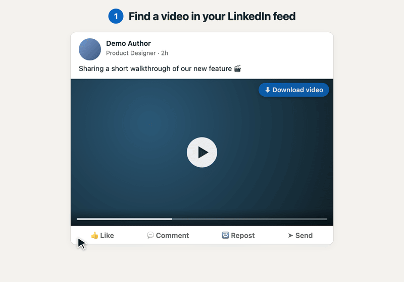
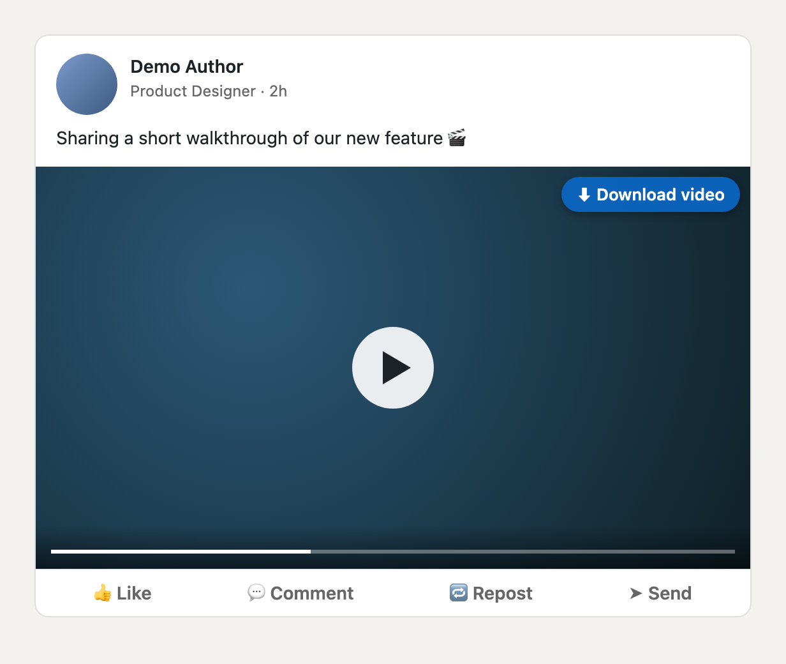
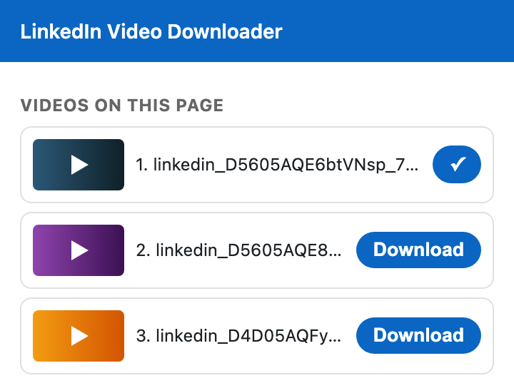

# DownloadLinkedIn

**English** | [简体中文](README.zh-CN.md)

<p align="center">
  
</p>

A lightweight Chrome extension (Manifest V3) that adds a **Download** button to videos in LinkedIn posts and saves them as full-length MP4 files with one click.

<p align="center">
  
  &nbsp;
  
</p>

<sub>Demo and screenshots use a mock post; no real LinkedIn content is shown.</sub>

## Features

- ⬇ A download button in the top-right corner of every post video — feed, post pages, profiles, search results
- 🎯 Each button maps to its own video, so you never get the wrong one in a busy feed
- 🎞 Picks the highest available progressive MP4 (currently 720p) — a complete file with audio, not `.m4s` fragments
- 📋 Toolbar popup that lists all loaded videos on the current page
- 🌐 English and Simplified Chinese UI, following your browser language
- 🔒 Minimal permissions: only `downloads` and `www.linkedin.com`; no tracking, no external servers

## Installation

1. Download or clone this repository:
   ```bash
   git clone https://github.com/chenkaitech/DownloadLinkedIn.git
   ```
2. Open `chrome://extensions` and turn on **Developer mode** (top-right).
3. Click **Load unpacked** and select the **`extension`** folder.
4. Refresh any open LinkedIn tabs.

Works in Chrome 111+ and other Chromium browsers (Edge, Brave, Arc…).

## Usage

- **On the page:** hover a video and click **⬇ Download video**. The file is saved to `Downloads/LinkedIn/linkedin_<assetId>_720p.mp4`.
- **From the toolbar:** click the extension icon to see every video on the current page and download any of them.

> Video URLs are signed and expire after a while. If a download fails on a page that has been open for a long time, refresh the page and try again.

## Localization

The UI language follows Chrome's language setting (`chrome://settings/languages`): Simplified Chinese for `zh-CN`, English otherwise. Strings live in `extension/_locales/<locale>/messages.json`; to add a language, copy `en/messages.json` to a new locale folder and translate the `message` values.

## How it works

LinkedIn's current player (video.js + Media Source Extensions) streams AV1/HLS fragments, so the `<video>` element only exposes a `blob:` URL and network requests only show `.m4s` segments. However, the player's React props (`playerParams.playlist[].sources`) also contain the progressive MP4 renditions, e.g.:

```
https://dms.licdn.com/playlist/vid/v2/<assetId>/mp4-720p-30fp-crf28/...
```

1. `inject.js` runs in the page's **MAIN world** so it can read the React fiber attached to the player's DOM node, and walks up the tree to find those sources.
2. `content.js` (isolated world) asks for the sources of the clicked `<video>` via `postMessage`, chooses the highest-resolution MP4, and renders the button.
3. `background.js` saves the file with `chrome.downloads`.

The legacy player, where URLs sit directly on `<video>` / `data-sources`, is also supported.

## Project structure

```
extension/
├── manifest.json   # MV3 manifest
├── inject.js       # MAIN world: reads player sources from React props
├── content.js      # Injects buttons, resolves MP4 URL, talks to background
├── content.css     # Button styles
├── background.js   # chrome.downloads
├── popup.html/js   # Toolbar popup
├── _locales/       # i18n strings (en, zh_CN)
└── icons/
docs/screenshots/   # README images
```

## Limitations

- Live streams and videos that only offer adaptive (HLS/DASH) streams aren't supported.
- LinkedIn changes its front end often; if the button reports "No MP4 found", please [open an issue](https://github.com/chenkaitech/DownloadLinkedIn/issues).

## Disclaimer

This project is not affiliated with, endorsed by, or sponsored by LinkedIn Corporation. Only download content you have the right to save, and respect the creators' copyright and LinkedIn's User Agreement.

## License

[MIT](LICENSE) © Chen Kai
