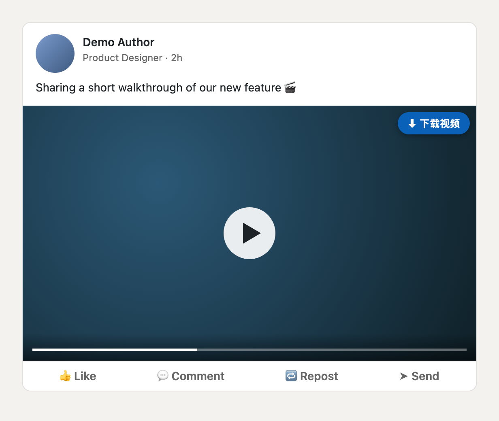
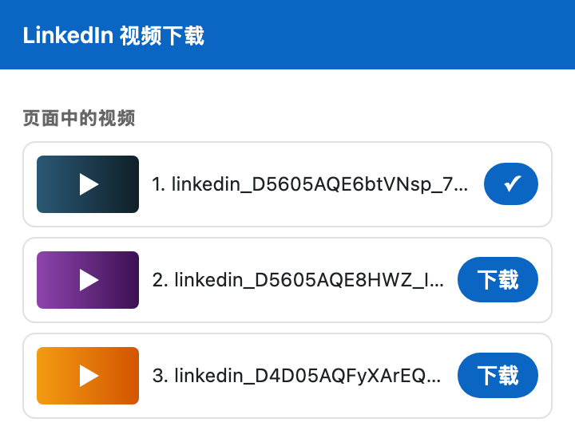

# DownloadLinkedIn

[English](README.md) | **简体中文**

一个轻量的 Chrome 扩展（Manifest V3），在 LinkedIn 帖子视频上添加「下载」按钮，一键保存完整的 MP4 文件。

<p align="center">
  
  &nbsp;
  
</p>

<sub>截图使用模拟帖子，不含真实 LinkedIn 内容。</sub>

## 功能

- ⬇ 每个帖子视频右上角都有下载按钮，动态、帖子详情、个人主页、搜索结果页均可用
- 🎯 按钮与视频一一对应，信息流中有多个视频也不会下错
- 🎞 自动选择最高清晰度的完整 MP4（目前为 720p），带音频，不是 `.m4s` 分片
- 📋 工具栏弹窗列出当前页面已加载的所有视频
- 🌐 支持简体中文与英文界面，自动跟随浏览器语言
- 🔒 最小权限：仅 `downloads` 与 `www.linkedin.com`，无统计、不连接任何第三方服务器

## 安装

1. 下载或克隆本仓库：
   ```bash
   git clone https://github.com/chenkaitech/DownloadLinkedIn.git
   ```
2. 打开 `chrome://extensions`，开启右上角「开发者模式」
3. 点击「加载已解压的扩展程序」，选择 **`extension`** 目录
4. 刷新已打开的 LinkedIn 页面

支持 Chrome 111+ 以及其他 Chromium 内核浏览器（Edge、Brave、Arc 等）。

## 使用

- **页面按钮**：鼠标移到视频上，点击「⬇ 下载视频」，文件保存到 `下载/LinkedIn/linkedin_<资源ID>_720p.mp4`
- **工具栏弹窗**：点击扩展图标，查看当前页面的所有视频并选择下载

> 视频地址带签名，一段时间后会过期。页面打开很久后下载失败时，刷新页面重试即可。

## 多语言

界面语言跟随 Chrome 的语言设置（`chrome://settings/languages`）：`zh-CN` 显示简体中文，其他语言显示英文。文案位于 `extension/_locales/<语言>/messages.json`；如需新增语言，复制 `en/messages.json` 到新的语言目录并翻译其中的 `message` 字段即可。

## 原理

LinkedIn 新版播放器（video.js + MSE）以 AV1/HLS 分片方式播放，`<video>` 上只有 `blob:` 地址，网络请求里也只能看到 `.m4s` 分片。但播放器组件的 React props（`playerParams.playlist[].sources`）中同时包含完整的 progressive MP4，例如：

```
https://dms.licdn.com/playlist/vid/v2/<assetId>/mp4-720p-30fp-crf28/...
```

1. `inject.js` 运行在页面的 **MAIN world**，可以读取播放器 DOM 节点上的 React fiber，并沿组件树向上找到这些 sources
2. `content.js`（隔离环境）通过 `postMessage` 请求所点击 `<video>` 的 sources，选出分辨率最高的 MP4，并负责渲染按钮
3. `background.js` 使用 `chrome.downloads` 保存文件

同时兼容旧版播放器（地址直接写在 `<video>` / `data-sources` 上）。

## 目录结构

```
extension/
├── manifest.json   # MV3 配置
├── inject.js       # MAIN world：从 React props 读取播放器 sources
├── content.js      # 注入按钮、解析 MP4 地址、与后台通信
├── content.css     # 按钮样式
├── background.js   # chrome.downloads 下载
├── popup.html/js   # 工具栏弹窗
├── _locales/       # 多语言文案（en、zh_CN）
└── icons/
docs/screenshots/   # README 截图
```

## 限制

- 不支持直播，以及只提供自适应码流（HLS/DASH）的视频
- LinkedIn 前端经常改版，若按钮提示「未找到完整 MP4 地址」，欢迎 [提交 Issue](https://github.com/chenkaitech/DownloadLinkedIn/issues)

## 免责声明

本项目与 LinkedIn 公司无任何关联，亦未获得其认可或赞助。请仅下载你有权保存的内容，尊重创作者版权并遵守 LinkedIn 用户协议。

## 许可证

[MIT](LICENSE) © Chen Kai
